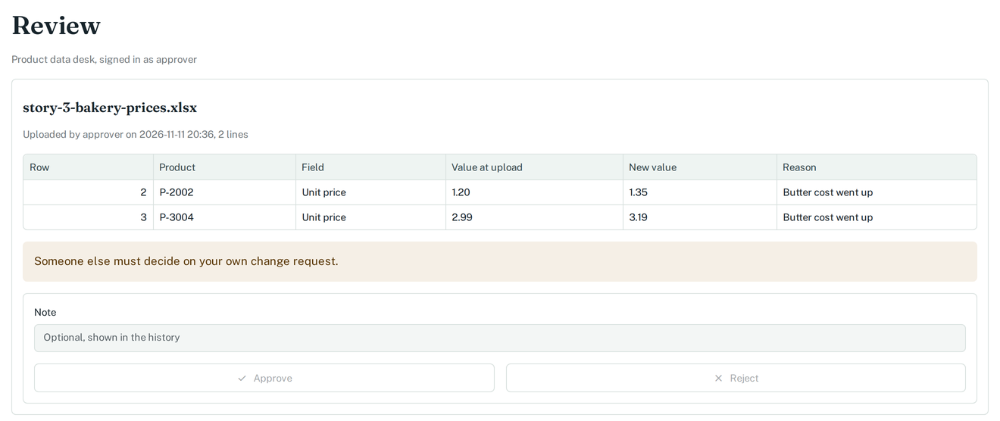

> **Update (14 Nov 2026):** [lakebase-patch-desk v1.1](https://github.com/AlexeyEvlampiev/lakebase-patch-desk/releases/tag/v1.1) runs the setup of roles and schemas in the same transaction as the SQL code and its tests, so a failing test rolls them back too; the grants from Databricks groups, the app and the jobs stay outside it. This article describes v1.0.

*A SQL-first architecture for guarded business operations, repeatable
Databricks delivery and a future path to authenticated AI agents,
demonstrated with a working approval application.*

## Abstract

Analytics and AI systems can propose changes to business data, but
accepting a change needs authorization, a durable state change and
control of conflicting decisions. Databricks now runs two engines side by
side for this: Spark on Delta for analytics, and PostgreSQL in Lakebase
for transactions. This article examines a SQL-first architecture that uses
both. A thin Databricks App calls named Lakebase PostgreSQL operations as
the signed-in person, without a separate custom API service. PostgreSQL
enforces the business rules and commits each decision with its event; a
separate Databricks job later publishes approved results to Delta under
Unity Catalog. One Declarative Automation Bundle delivers the parts with
the toolchain data teams already use, and a database deploy job runs SQL
tests that must pass before the database changes commit.

A working approval application on Azure Databricks shows per-person
database access, refusal of self-approval independently of the user
interface, and asynchronous publication to Delta. The same operations
could serve authenticated AI agents: the demo tests the agent rules in
SQL, but runs no language-model agent or remote MCP server yet. The
pattern fits short, database-local transactions whose analytical consumers
can accept delayed visibility. A conventional service remains the better
choice when an operation mainly coordinates external systems.

![Two columns inside one Databricks frame. Left, in Spark orange, Apache Spark on Delta: analyzes; large scans and aggregates, dashboards, pipelines and ML, sees approved changes later. Right, in PostgreSQL blue, PostgreSQL in Lakebase: runs the business; checks who asks, all or nothing (done or refused), answers at once. An arrow carries approved facts from PostgreSQL to Delta, later. Along the bottom: both live in Databricks, with one identity, Databricks Apps and one bundle. Note: no shared transaction; PostgreSQL commits the decision and Delta receives a copy later.](fig0-two-engines.drawio.svg)

## 1. The architectural problem

The pipeline is built and the numbers are in Delta. Now business users
must correct and approve some of them, and the usual answer is to ask a
web team for an application.

Suppose an analytical process finds product prices that need correction.
A report or an AI assistant can propose new values, but accepting them is
a different kind of operation. The system must know who submitted each
proposal, stop people from approving their own change, reject stale or
conflicting decisions, record the outcome, and eventually make the
approved values available for analysis.

A notebook or a pipeline can process the data, but it is not a design
for concurrent user decisions and guarded transactions. Teams usually add
an application service and an operational database next to the analytical
platform. That remains a sound solution.

The alternative examined here is narrower. For workflows whose business
rules work mainly on PostgreSQL state, put those rules in named Lakebase
PostgreSQL functions and let Databricks Apps call them. Keep Spark and
Delta responsible for analytical processing, and publish operational
changes to them asynchronously. Deliver the application, its jobs and the
database through the Databricks toolchain.

The question is therefore not whether Databricks replaces backend
engineering. It is which transactional capabilities can be built and
maintained coherently inside a Databricks-centred solution, and which
boundaries make that choice safe.

## 2. The proposed architecture

The design separates three responsibilities: analytical processing,
transactional decisions, and delivery of the solution.

A user submits a correction through a Databricks App. The app connects to
Lakebase as the signed-in person and calls a named PostgreSQL operation.
The operation checks the caller's permissions and the current business
state, then either rejects the request or commits the change and its event
in one database transaction. A separate Databricks job later publishes
approved values to Delta, where Unity Catalog, the [governance
layer](https://learn.microsoft.com/azure/databricks/data-governance/unity-catalog/)
for data and AI in Azure Databricks, controls access for analysts.
PostgreSQL owns the decision; Delta receives an eventually consistent
analytical copy. The two systems do not share a transaction.

Delivery is separate from runtime. One Declarative Automation Bundle
declares the app, the Lakebase project and the jobs; section 4 shows how
they are deployed.

![Runtime. Left: a person signs in to Databricks and uses a Streamlit app in Databricks Apps, which calls operations as the person's own database login. Centre: Lakebase PostgreSQL, where named business operations (submit, approve, reject) check who asks and the current state, then change tables and events in one transaction per operation; people hold no table privileges. A dashed AI agent path to the same operations is proposed, its rules tested in SQL only. Right, beyond a dotted line marked "no shared transaction": an export job publishes approved values later to a Delta table governed by Unity Catalog, used by analytics and AI.](fig1-architecture.drawio.svg)

*Figure 1. Runtime. The app calls a named PostgreSQL operation as the
signed-in person. The operation checks the caller and the state, and
commits the change and its event in one transaction. A separate Databricks
job later publishes approved values to Delta. There is no shared
transaction. The AI agent path (dashed) is proposed, not demonstrated.*

Each control comes from a different place:

| Control | Provided by |
|---|---|
| User sign-in, forwarded token, short-lived database credential | Databricks and Lakebase |
| Business rules, authorization checks, events | The application's PostgreSQL functions |
| No direct table privileges for people; row-level security forced on the table owner, which has no `BYPASSRLS` | The application's grants and policies |
| Tests before the database changes commit | The deploy tool, in SQL |
| Publication to Delta | The application's Databricks job |

## 3. Why SQL-first, and when not

**A business operation is not a table update.** Approving a correction
reads several records, checks who is asking, checks the current state,
changes the data and writes an event, all in one transaction. Clients
should request that operation by name, not edit the tables behind it.
People receive the right to execute the operation, not privileges on
its tables.

In the demo, approval is one PostgreSQL function. (The code says "patch"
where this article says "correction request".) The app opens a PostgreSQL
connection as the signed-in person and calls the routing function
`api.rest_invoke` with the request `POST /patches/{id}/approve`. That
request names the business operation; it is not an HTTP endpoint, and the
app calls no separate API service. The routed function checks the caller
and the current state, applies the correction and writes its decision
event in one PostgreSQL transaction. Its contract:

| Contract element | Approve a correction |
|---|---|
| Request | Request id; for a person's own login, the caller is taken from the login, never from the request |
| Preconditions | Request still pending; caller is an approver; caller did not submit it; no product changed since the upload |
| Atomic effect | Apply the corrected values to the products, record the decision and write the event, in one transaction |
| Rejection | An explicit code (`own_patch`, `not_approver`, `not_pending`, `stale`) and no change at all |
| Callers | The Databricks App today; other adapters could call the same function |

Small dispatchers written in SQL, shaped like REST, RPC and MCP, route
requests to the same core functions. They are the demo's own code, not a
Lakebase feature. A remote client still needs
a transport in front of PostgreSQL: a thin service, an MCP server, or the
[Lakebase Data
API](https://learn.microsoft.com/azure/databricks/oltp/projects/data-api),
which can call database functions as RPCs. Each transport needs its own
tested way to pass the caller's identity.

The boundary is not secure because it is written in SQL. It depends on
correct authentication, grants and privileged-function design, and on
tests of the authorization rules.

**When this beats a separate service.** The operation's rules work mainly
on data in PostgreSQL; the change must be atomic and consistently
authorized; several clients need the same rules; and the team is fluent
in SQL. Then the rules have one authoritative implementation, next to the
state they protect, and the surrounding code (app, API, MCP adapter)
handles only interaction, authentication and protocol.

**When it does not.** The operation mainly coordinates external systems,
waits on long-running work, or needs complex behavior outside the
database. A service-led design is then usually better, and it can still
use Lakebase for persistence. SQL-first does not mean SQL-only: Python or
another language remains the right place for user interfaces, external
integration and AI orchestration. Business operations in the database
also tie the application to PostgreSQL schemas, privileges and deploy
practice, and they still need versioning, tests, monitoring and an owner.

## 4. How the solution is delivered

One [Declarative Automation
Bundle](https://learn.microsoft.com/azure/databricks/dev-tools/bundles/)
(formerly a Databricks Asset Bundle) declares the Databricks App, the
[Lakebase
project](https://learn.microsoft.com/azure/databricks/dev-tools/bundles/resources#postgres_projects)
and two jobs: one deploys the database code, the other exports approved
data to Delta. Bundle support for Lakebase is in Beta. A Databricks team
gets one versioned release workflow for the analytical and transactional
parts, with the toolchain it already uses for jobs and pipelines. It does
not get a distributed transaction across them.


*Figure 2. Delivery. The repository's deploy script applies the bundle,
runs the database deploy job, then starts the app. It can first create
the resource group and the Azure Databricks workspace with the Azure CLI.
Only the SQL changes and their tests share one database transaction.*

PostgreSQL functions and access rules are application behavior. A
database deploy can succeed technically and still let users approve their
own requests. So the database deploy job runs
[pgmi](https://github.com/vvka-141/pgmi), an open-source PostgreSQL deploy tool by the author, in which the deploy and its tests are written in
SQL. The job sets up roles and schemas, runs the SQL code and its tests in
one transaction, and finally grants people database access from their
Databricks groups. If a test fails, the changes made inside the
transaction roll back. In an earlier lab run on a Lakebase branch, a
deliberately failing test stopped the deploy, and neither the changed
function nor a deploy record was committed. Any deploy approach that makes
critical operations testable and repeatable meets the same need; pgmi is
how this demo meets it.

This is a coordinated release, not one atomic release. The setup before
the transaction, the grants after it, the app, the jobs and other
Databricks resources are outside its rollback.

## 5. Working evidence

The demo ran on Azure Databricks (westeurope) on 11 November 2026, built from an empty resource group with the deploy script of the demo
repository, [lakebase-patch-desk](https://github.com/AlexeyEvlampiev/lakebase-patch-desk/tree/v1.0). The
Databricks App connects to Lakebase as the signed-in person: Databricks
forwards the user's token, the app exchanges it for a short-lived database
credential, and PostgreSQL authenticates the person's own login. The app's
service principal has no database role. That is deliberate: when you [add
Lakebase as an app
resource](https://learn.microsoft.com/azure/databricks/dev-tools/databricks-apps/lakebase),
Azure Databricks creates a PostgreSQL role for the app's service principal
with `CONNECT` and `CREATE` on the database. The demo declares no such
resource and works only as the signed-in person.

**The user interface guides.** The app disables Approve on a person's own
request.



*UI guidance, not enforcement: the approver's own request in the
deployed app. The test users are named `uploader` and `approver`.*

**The database enforces.** The same attempts, made directly in PostgreSQL
as the approver's own Lakebase login, are refused. The second statement is
the SQL call the app itself makes (output abbreviated: the request id is
shown as `<own id>`, long parts as …):

```
UPDATE core.patch SET state = 'approved' WHERE true;
ERROR:  permission denied for schema core

SELECT … FROM api.rest_invoke('POST', '/patches/<own id>/approve', NULL, '{}');
 403 {"code": "core.patch.own_patch", … "detail": "Someone else must decide your own patch"}
```

The person's login has no rights on the tables, and the one operation it
may call still refuses. An attempt to take over the table owner's role
with `SET ROLE` was refused as well.

**The rule is a release condition.** The database tests run inside the
deploy transaction and cover what must be refused and what must still
work. Simplified:

```sql
-- Simplified. Full test: db/api/__test__/test_patch_handlers.sql
r := api.rest_invoke('POST', '/patches/' || own_id || '/approve', ann_headers, '{}');
IF r.status_code <> 403 THEN
    RAISE EXCEPTION 'TEST FAILED: self-approval must be refused';
END IF;
```

If a change let self-approval through, this exception would abort the
deploy transaction. On the demo deploy, the suite passed on Lakebase.
These API tests run on the privileged deploy connection and name the test
person in request headers, a path a person's own login cannot use. So
they do not by themselves prove the app's per-person login path; the
direct-login capture above checks that boundary. Two further
login-switching tests need a superuser and run only on local PostgreSQL.

The full tests are in
[`db/api/__test__/`](https://github.com/AlexeyEvlampiev/lakebase-patch-desk/tree/v1.0/db/api/__test__).

**Delta receives the decision later.** After the approval committed, the
export job merged the approved values into a Delta table, each product row
with the request that changed it.

| Demonstrated | Not demonstrated |
|---|---|
| The human workflow in a Databricks App, connected as the person | A language model choosing operations |
| Approval rules enforced by PostgreSQL, also outside the app | A remote MCP server and its authentication to Lakebase |
| SQL tests on every deploy, passed on Lakebase | A two-session test of simultaneous approvals |
| Asynchronous publication of approved data to Delta | Exactly-once or ordered delivery to Delta |

## 6. Implications for AI agents

The same operation boundary can serve an AI caller without giving the
model access to application tables. An agent may find a wrong price in
lakehouse data and propose a correction. If it requests the same submit
operation the app uses, PostgreSQL applies the same permissions,
preconditions and state rules, and the agent cannot skip approval even if
its model wrongly concludes that approval is unnecessary. A prompt such as
"never approve your own submission" is not an authorization boundary; the
function is.

The demo runs no language-model agent or remote MCP server. It tests an
MCP-shaped dispatcher and the agent delegation rules inside PostgreSQL: an
agent acts through a connection its person authorized, holds at most that
person's permissions, and each request records both. The deploy tests
show that an agent's attempt to approve its own person's correction is
refused with `core.patch.own_patch`, and that unknown, revoked, expired
and other people's connections are refused. A deployed adapter, for
example an MCP server, would still have to authenticate the agent and the
person it acts for, pass that authority to the database without letting
the agent manufacture it, and handle revocation. The SQL tests do not
demonstrate those end-to-end properties.

Retries need one more piece. If a submission commits and the response is
lost, a retry creates a second pending request in the demo, because submit
has no idempotency key. An agent-facing submit should accept a stable
operation id, so a repeated request returns the first result instead of
creating a new one. The result so far is a reusable business-operation
boundary for future human and agent clients, not a finished AI agent.

## 7. Decision boundaries and conclusion

Three conditions decide whether the pattern fits:

- **Rules are local to PostgreSQL state and transactions are short.**
  Then SQL business operations are a good boundary. When an operation
  mainly coordinates external services or long-running work, use a
  service-led design.
- **Analytical consumers can accept delayed visibility.** Approved data
  reaches Delta asynchronously. The demo's export runs one job at a time
  and its merges can safely repeat, but it has no version guard against
  out-of-order writes. Lakebase also offers a native [Change Data
  Feed](https://learn.microsoft.com/azure/databricks/oltp/projects/lakebase-cdf),
  in Public Preview, which moves row changes rather than approved business
  facts.
- **Identity can be carried to the database.** The demo gives each person
  their own login. Lakebase allows [500 PostgreSQL roles per
  branch](https://learn.microsoft.com/azure/databricks/oltp/upgrade-to-autoscaling),
  and its [built-in connection
  pooler](https://learn.microsoft.com/azure/databricks/oltp/projects/connection-pooling)
  does not accept these OAuth logins. In the demo, access follows the
  Databricks groups at each deploy, and open connections are not closed when someone
  leaves. Larger applications may need a shared service identity, and
  then the database must not accept a user id that a client could forge.

Passing tests show that the tested behavior works in the tested
environment. They are not a security or production-readiness
certification, and privileged functions need review and an owner.

The working example supports a specific choice. For short business
operations whose authorization and state changes are mostly local to
PostgreSQL, Lakebase can own the transactional boundary: the SQL data
model is the backend, a thin Databricks App provides the interaction
without a separate custom API service, and Delta remains an asynchronous
analytical copy. The database enforces the tested approval rule
independently of the user interface, and one Databricks release workflow
delivers the parts with a separately tested database commit. This does
not establish production security, correct behavior under every
concurrent interleaving, or exactly-once, ordered publication to Delta.

Choose a service-led design when an operation mainly coordinates external
systems, runs long, or needs a different identity and operations model.
For the narrower SQL-first case, the benefit is not that backend
engineering disappears. It is a smaller custom service surface around one
authoritative set of business operations, delivered with a workflow
Databricks teams already know, and ready for future authenticated AI
callers. In short: Spark analyzes, PostgreSQL runs the business, and both
live in Databricks.

The [demo repository](https://github.com/AlexeyEvlampiev/lakebase-patch-desk/tree/v1.0) holds the working system and the tests
behind these conclusions. With its [deploy
guide](https://github.com/AlexeyEvlampiev/lakebase-patch-desk/blob/v1.0/README.md#deploy-the-demo) you can deploy the demo from an empty
resource group; the SQL tests run on every deploy.

## References

- [lakebase-patch-desk: the demo repository](https://github.com/AlexeyEvlampiev/lakebase-patch-desk/tree/v1.0)
- [pgmi: PostgreSQL deployments written in SQL](https://github.com/vvka-141/pgmi)

- [What is Unity Catalog?](https://learn.microsoft.com/azure/databricks/data-governance/unity-catalog/)
- [What are Declarative Automation Bundles?](https://learn.microsoft.com/azure/databricks/dev-tools/bundles/)
- [Declarative Automation Bundles resources: Postgres projects](https://learn.microsoft.com/azure/databricks/dev-tools/bundles/resources#postgres_projects)
- [Configure authorization in a Databricks app](https://learn.microsoft.com/azure/databricks/dev-tools/databricks-apps/auth)
- [Add a Lakebase resource to a Databricks app](https://learn.microsoft.com/azure/databricks/dev-tools/databricks-apps/lakebase)
- [Lakebase authentication](https://learn.microsoft.com/azure/databricks/oltp/projects/authentication)
- [Lakebase Data API](https://learn.microsoft.com/azure/databricks/oltp/projects/data-api)
- [Lakebase Change Data Feed](https://learn.microsoft.com/azure/databricks/oltp/projects/lakebase-cdf)
- [Connection pooling](https://learn.microsoft.com/azure/databricks/oltp/projects/connection-pooling)
- [Upgrade to Autoscaling (limits)](https://learn.microsoft.com/azure/databricks/oltp/upgrade-to-autoscaling)

## Related writing

- [Decoupling Compute and Storage in Postgres: The Architectural Implications of Databricks Lakebase](/posts/decoupling-compute-storage-postgres-lakebase/): what Lakebase is; this article builds on it.
- [Operational and Analytical Are Not Separate Architectures](/posts/operational-and-analytical-are-not-separate-architectures/)
- [A Decision Belongs Where Its Authority Lives](/locality-of-authority/)

*Drafted with AI assistance. The architecture, code, tests and conclusions are the author's own and were verified by the author.*

*Alexey Evlampiev is a data and AI architect and Databricks Champion,
working on enterprise data platforms, PostgreSQL and transactional
applications.*
